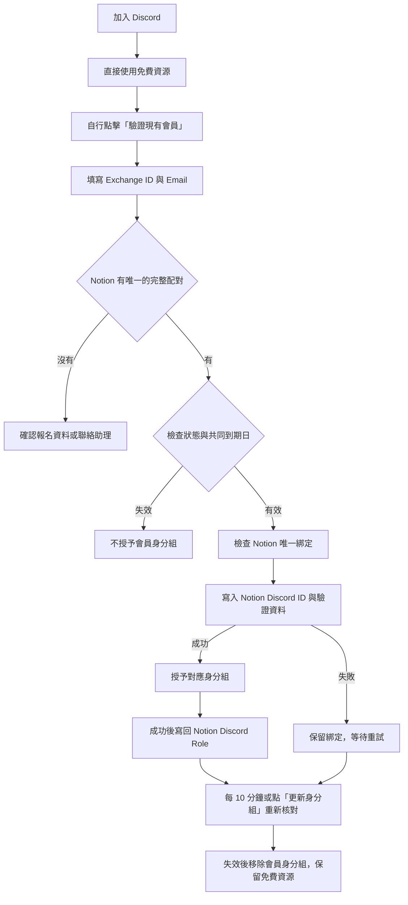

# Xplan Discord 現有會員驗證

已加入預設關閉的會籍 V2：三交易所身份配對、Notion 付款／交易量獨立事實、免費探索者及安全的成員枚舉。啟用規則、必要欄位與分階段切換見 [MEMBERSHIP-V2.md](MEMBERSHIP-V2.md)。以下原有流程及線上驗收紀錄保留為 V1 歷史參考。

此套件已整合至 Xplan-TG-Bot repository 的 `apps/discord-bot/`，保留獨立 Worker、依賴與既有功能。整合與測試入口見 [同 repository 的開發方式](../../docs/discord-integration.md)。下方與 `DEPLOYMENT.md` 的線上驗收紀錄是原專案的歷史快照；此次匯入未重新部署或確認正式環境。

第一版讓 Notion 既有會員在 Discord 輸入 **Exchange ID＋Email**，直接比對同一筆報名資料及會籍狀態，取得對應身分組。加入 Discord 後可先使用免費資源，由會員自行啟動驗證。

後端於 2026-09-08 部署至 Cloudflare，2026-09-09 已移除 SQLite 並改由 Notion 保存綁定。Discord 互動端點已通過簽章驗證，bot 權限、`/verify` 與[驗證入口](https://discord.com/channels/1524719558504747039/1524855788340776987/1546785760957571085)均已完成。已確認真實會員提交後的綁定與排程角色授予；部署核對與頻道權限現況見 [DEPLOYMENT.md](DEPLOYMENT.md)。

## 會員流程



- Exchange ID 對應 Notion 的 `Exchange UID`，Email 對應 `Email`。兩者必須落在同一筆記錄，不能分別匹配不同會員。
- 不寄驗證碼、不要求 Telegram 帳號或新填報名表。輸入欄位與回覆使用 Discord 僅本人可見的互動。
- TG 與 Discord 共用 `Review Due At`。綁定、重新驗證與退出重進不重新起算，也不另外添加寬限期。
- Notion 是唯一的會員與綁定資料來源。驗證時寫入 `Discord_id` 及三個專用校驗欄位，角色操作成功後另寫入 `Discord Role`；重用 `Status`、`Review Due At` 與付款日期。正式服務不使用 SQLite。
- 本版只處理**現有會員驗證與權限同步**。Discord 新會員申請試用、續費通知與付款收件留待後續；助理沿現有流程更新 Notion 後，Discord 會讀取新的狀態與期限。

## 狀態與身分組

| Notion 狀態／資料 | 處理 |
| --- | --- |
| `expire`／`expired`、`kick`／`kicked`、`deny`／`denied`、空白狀態、封存紀錄 | 拒絕；已有綁定者移除受管理的會員身分組 |
| 非免續費會員已超過 `Review Due At` | 即使 Status 尚未更新，也按共同到期日撤權 |
| `trial_active` | 「探索者」身分組 |
| `active_paid`、`eligible` | 「宇航員」身分組；有到期日時仍須未到期 |
| `exempt`、`VIP` | 「宇航員」身分組，免續費 |
| `partner` | 「飛行員」身分組，免續費 |
| `join_pending` 且有有效付款時間及未到期期限 | TG 付費後重新入群分支，授予正式會員身分組 |
| 提醒等其他非空白、非失效狀態 | 曾確認同一付款／期限週期的類型則沿用；否則預設試用身分組 |
| 未失效但未設定到期日 | `active_paid`、`eligible` 給正式角色，其餘預設試用；保留空白日期，不重新起算 |
| 日期格式無法解析 | 不新授權，請助理確認；不根據不完整資料修改既有角色 |

使用者要求依失效狀態排除，因此不再將 `eligible`、`collecting_info` 等既有紀錄一律擋下。`eligible` 已明確指定為正式會員角色。驗證只授予 Discord 角色，不會執行新試用申請或起算日期。

2026-09-10 起 `partner` 使用獨立的「飛行員」。既有綁定在按「更新身分組」或下次排程時，自動更新原有的類型校驗值並換組；不新增 Notion 欄位、不修改共用會員期限。狀態改為 `exempt` 或一般會員時會移除「飛行員」並依目前狀態授權，失效則撤除受管理的會員角色。原 `partner` 類型不能在提醒狀態中沿用。

**資料不完整時的角色為暫定設定**：`INCOMPLETE_MEMBER_POLICY=trial` 讓未失效但缺日期／類型不明者先取得試用角色；明確指定的 `active_paid`、`eligible` 仍給正式角色；改成 `review` 則要求助理確認後才新授權。空白日期在 Notion 補齊前無法依日期自動到期，仍持續檢查失效狀態。

`Paid At` 可能是歷史付款，不能單憑此值判定提醒中的會員為付費。`MEMBER_TIER_OVERRIDES` 可由營運人員明確指定需要補判的 Notion page UUID 為 `trial` 或 `paid`；它不能繞過失效狀態、日期錯誤或到期。換期或變更類型後需重新審視此設定。

日期與 TG bot 一樣使用 JavaScript 日期解析；只有年月日的日期按 UTC 零時解讀，顯示時轉成台北時間。

## 綁定與故障處理

- 每筆 Notion 會籍最多綁定一個 Discord 帳號；同一 Discord 帳號也不能自行改綁另一筆會籍。換綁需助理核實，目前沒有自助解除綁定或管理後台。
- Notion 綁定寫入確認後才新增會員角色。若 PATCH 回應失敗或結果不確定，非 SQLite 的 KV 工作狀態保留待重試操作；此帳號／會籍在結果核對前不能改綁別人。成功確認後刪除待重試操作。未變更的排程不重寫驗證資料。
- 驗證、手動更新與每 10 分鐘排程，都在 Discord 操作成功後將角色名稱寫入 `Discord Role`。角色不變時不重複 PATCH。有效綁定的角色被撤除或會員不在伺服器時清空欄位；Discord 操作失敗、規則確認未完成或待人工確認時不記錄新的授權。
- `Discord Role` 是最近一次成功同步的結果，不參與資格判斷。若 Discord 成功而 Notion 寫入失敗，保留已完成的角色操作，回覆明確的重試提示，並在下一輪從最新會籍重試；不因紀錄寫入故障阻止撤權。若管理員手動移除綁定或封存頁面，舊頁面的結果欄位可能保留歷史值，不能拿它作為目前會員資格。
- Notion 欄位已有不同 ID 時不覆蓋；同一 Discord ID 出現在多筆會員記錄時停止授權。清空 `Discord_id` 或封存會員後，排程會撤除原帳號的會員角色；不會從外部會員資料庫補回綁定。手動換 ID 不代表通過驗證，因憑證摘要也綁定原 Discord ID，新帳號需自行驗證。
- 已讀取到失效或到期狀態時先撤權，不依賴校驗欄位 PATCH 成功。Notion 一般讀取或完整分頁失敗時保留既有角色，避免把上游故障當作所有會員消失。
- 每個 Discord 帳號每 15 分鐘最多驗證 5 次，整個伺服器每 15 分鐘最多 300 次。查不到完整配對或配對重複時顯示相同提示。
- Notion 查詢完整分頁，對 Email 與 Exchange ID 去除前後空白、忽略英文字母大小寫；Exchange ID 不轉成數字，保留開頭的零。
- 外部請求設逾時且不跟隨重新導向。Notion 錯誤不視為所有會員失效：停止新授權、保留既有角色，之後重試。因此上游故障可能延後實際撤權。
- 已綁定紀錄的 Exchange ID 或 Email 改變時，撤除原會員角色並要求重新配對。Notion 直接回傳 404 按讀取失敗處理，需助理確認是否刪除紀錄或撤銷 integration 權限。
- 只增刪設定的會員身分組，不改動其他角色、不踢人。伺服器規則確認未完成者不先授權；頻道覆寫需要在 Discord 另行正確設定。
- 同步為每 10 分鐘排程，也可自行點擊更新。Discord 限流／權限錯誤會記錄失敗，留待下一輪重試。
- Discord 互動必須通過 Ed25519 簽章、時間戳、Application ID 與 Guild ID 檢查；沒有公開管理 API。
- Notion 儲存 Discord ID、驗證時間、綁定 Discord 帳號的 Exchange ID＋Email HMAC，以及會員類型校驗值。Notion page ID 使用頁面本身，不建立重複欄位。不重複保存明文驗證資料或日期；互動 Token 不持久化，日誌僅輸出清理後的錯誤類別。
- `AUTH_SECRET` 是固定的服務端密鑰，至少 32 字元。不可每次部署重建；更換會導致既有摘要失配並要求重新驗證。

## 已指定的 Discord 設定

| 項目 | ID／對應 |
| --- | --- |
| 伺服器 | `1524719558504747039` |
| 驗證頻道 | `1524855788340776987` |
| 試用角色 | `1524805277231222994`：`trial_active` |
| 正式角色 | `1524806322401448026`：`active_paid`、`eligible`、`exempt` |
| Partner 角色 | `1524807192434311390`：`partner` |

`exempt` 保留原本免續費語意，實際授予正式角色。Application ID `1546535242851029072`（Xplan管理員）已接入，互動端點已設定；Token 存於本機忽略檔及 Cloudflare Secrets。伺服器內的驗證入口已建立，bot 安裝與權限核對均通過。

## 開發與測試

需要 Node.js 22.18 以上。

```sh
npm ci
npm run typecheck
npm test
npm run test:runtime
```

`npm test` 驗證 Notion 配對與唯一綁定、跨重啟限流／去重、失敗重試、提醒階段的類型校驗、Discord adapters 與簽章 HTTP。`test:runtime` 在 Miniflare/workerd 使用 `useSQLite: false` 執行完整流程，涵蓋寫入重試、付款升級、校驗值、上游故障、到期、角色結果寫回與重試，以及清除綁定後撤權。全部 API 以合成資料攔截，不修改正式會員。

若原始碼放在 SMB 目錄，建議先同步到本機 `/tmp` 工作目錄，再安裝依賴、測試及打包；不要把 `.dev.vars` 或密鑰加入原始碼同步清單。

## 正式環境設定

1. 在 Discord Developer Portal 建立／選擇專用 Application 和 bot，取得 Application ID、Public Key、Bot Token。以 `bot` 和 `applications.commands` scopes 安裝到指定伺服器。服務使用 HTTP Interactions，不需要 Gateway 或 Message Content／Server Members privileged intent。
2. 準備驗證文字頻道與探索者、宇航員、飛行員身分組。Bot 最高角色須高於它管理的會員角色，具有 Manage Roles，並能在驗證頻道查看、傳送、讀取歷史訊息。會員角色不能帶管理權限。
3. 設定頻道權限：會員區禁止 `@everyone` 查看，再允許會員角色；免費區與驗證入口供一般成員使用。安裝腳本不變更頻道覆寫。
4. 將 `.dev.vars.example` 複製為 `.dev.vars` 並填妥設定。`npm run check:config` 檢查格式；`npm run discord:setup -- --plan` 預覽指令、入口訊息及 bot 安裝網址。兩者均不連線、不送訊息。
5. `npm run discord:setup -- --check` 唯讀核對 bot、頻道、角色、層級和權限。
6. `node scripts/notion-role-setup.mjs --check` 檢查結果欄位，缺少時使用 `--apply` 新增唯一的 `Discord Role` 單選欄位。先 `npx wrangler whoami` 確認 Cloudflare 帳號，再 `npm run deploy` 建立 Worker 與 KV-backed `NotionMemberGate`。用 `wrangler secret put` 提供 `.dev.vars.example` 中必要的服務端設定；`.dev.vars` 不會自動上傳。Notion data source ID 與 Email 欄位名稱已放在 `wrangler.jsonc`。
7. 將 `https://<Worker 網域>/interactions` 設為 Discord Application 的 Interactions Endpoint URL，通過簽章 PING。`/healthz` 僅表示 HTTP 存活，不代表已完成所有設定。
8. 正式服務設定齊全後，`npm run discord:setup -- --apply` 建立／更新 `/verify` 及驗證入口。腳本只 upsert 這一個指令，不覆蓋其他指令；優先編輯 `DISCORD_PANEL_MESSAGE_ID`，否則在最近 100 則訊息找入口重用。保存回傳的訊息 ID，避免重複建立。
9. 用指定測試會員實際驗證一次，核對領取角色及頻道可見範圍，再開放全體使用。不透過修改真實會員到期日來測試。

| 設定 | 用途 |
| --- | --- |
| `DISCORD_APPLICATION_ID`、`DISCORD_PUBLIC_KEY`、`DISCORD_BOT_TOKEN` | Discord Application 與 API |
| `DISCORD_GUILD_ID` | 唯一目標伺服器 |
| `DISCORD_TRIAL_ROLE_ID`、`DISCORD_MEMBER_ROLE_ID` | 試用／正式角色，必須不同 |
| `DISCORD_PARTNER_ROLE_ID` | 必填，`partner` 的「飛行員」，須與其他受管理角色不同 |
| `DISCORD_NON_EXPIRING_ROLE_ID` | 選填，`exempt`／`VIP` 的角色；本伺服器設定為「宇航員」 |
| `DISCORD_VERIFICATION_CHANNEL_ID`、`DISCORD_PANEL_MESSAGE_ID` | 安裝腳本的入口頻道及訊息 |
| `NOTION_API_KEY` | 可讀取共用會員來源且具備 Update content 能力的 integration token |
| `NOTION_DATA_SOURCE_ID` | `34f50abc-cc15-803c-bee1-000bfc6404cb`，不是外層 database ID |
| `NOTION_EMAIL_PROPERTY` | 預設 `Email` |
| `NOTION_DISCORD_ID_PROPERTY` | 預設 `Discord_id`（注意大小寫），必須為文字 rich_text，不能用 number 保存長 ID |
| `AUTH_SECRET` | 至少 32 字元的隨機固定密鑰 |
| `INCOMPLETE_MEMBER_POLICY` | `trial` 或 `review`；預設 `trial` |
| `MEMBER_TIER_OVERRIDES` | 選填 JSON：Notion page UUID → `trial`／`paid` |

## 核對來源

2026-09-09 API 確認 `Discord_id` 為 rich_text，新增三個校驗欄位後原有屬性均保留。2026-09-13 新增 `Discord Role` 單選欄位並確認原欄位 ID／型別不變。回寫使用 [Notion Update page](https://developers.notion.com/reference/patch-page)：綁定 PATCH 僅包含四個驗證屬性，角色結果 PATCH 僅包含 `Discord Role`。

使用者於 2026-09-08 確認 [Tally 報名表](https://tally.so/r/RGYNNl) 寫入 [Notion X翻倉報名表](https://app.notion.com/p/34f50abccc1580ef9516c8f95e51e163)。本版不需要 Tally webhook。

2026-09-08 唯讀 API 核對：`Email` 為 email、`Status` 為 select，期限及付款日期欄位為 date；查詢欄位名稱篩選及 page GET 的 `parent.data_source_id` 與程式吻合。有 Email 的 65 筆紀錄，正規化後沒有重複信箱。這是當時的匿名快照，執行時仍逐次驗證完整配對。

TG 版本與流程研究見 [TG-BOT-RESEARCH.md](TG-BOT-RESEARCH.md)。技術依據：[Discord 簽章及回覆](https://docs.discord.com/developers/interactions/receiving-and-responding)、[Modal](https://docs.discord.com/developers/components/using-modal-components)、[Guild roles](https://docs.discord.com/developers/resources/guild)、[Cloudflare KV-backed Durable Object](https://developers.cloudflare.com/durable-objects/api/legacy-kv-storage-api/)。

## Notion 欄位與資料來源

| 欄位 | 型別 | 用途 |
| --- | --- | --- |
| `Discord_id` | Text（原有） | 唯一綁定的 Discord 帳號，保留完整字串 |
| `Discord Verified At` | Date（新增） | 最後通過 Exchange ID＋Email 配對的時間 |
| `Discord Credential Hash` | Text（新增） | 綁定 Discord ID 的配對摘要；修改 ID、Email 或 Exchange ID 後須重新驗證 |
| `Discord Tier Proof` | Text（新增） | 已確認會員類型與當期會籍的 HMAC 校驗值，支援 TG 提醒狀態中的角色判斷 |
| `Discord Role` | Select（2026-09-13 新增） | Discord 操作成功後的身分組：探索者／宇航員／飛行員；沒有會員角色時清空 |

`Discord Verified At` 按分鐘保存：實際 Notion Date 寫入會省略秒與毫秒，程式會在寫入／確認前統一精度，既有待重試操作也適用。會員到期日、付款日期及身份校驗值不做此精度調整。

`Status`、`Review Due At`、`Paid At`、`Payment Deadline At`、`Exchange UID` 和 `Email` 均重用原欄位；不新增 Discord 專用會員狀態、到期日、付款日、Email 或 Exchange ID 副本。`Discord Tier Proof` 只保存類型和校驗值，不保存日期副本；共同期限或付款日期變動時舊校驗值失效，重新依現有會籍判斷。

Cloudflare 的 `NotionMemberGate` 使用 **KV-backed Durable Object（use_sqlite=false）**，負責序列化同伺服器的驗證與同步。KV 只保存限流、事件去重、未完成寫入的重試操作，以及需追蹤撤權的 Discord 帳號集合；沒有會員表、Notion page 對應表或會員日期快照。未完成操作確認成功後移除；撤權追蹤本身不能授權。

排程從 Notion 枚舉已綁定會員；角色追蹤集合只用於找出 Notion 中已清空／封存的舊帳號並撤權。即使清空運作快取，仍可從 Notion 還原現有有效會籍的同步，毋須重建外部會員資料庫。

此 Cloudflare 帳號已有舊式 KV namespace，已實際確認可以建立非 SQLite 後端；Cloudflare 對新帳號的可用後端限制不同，詳見 [Durable Object storage backends](https://developers.cloudflare.com/durable-objects/reference/durable-objects-migrations/)。`wrangler.jsonc` 中 v1 的 SQLite 宣告僅為歷史 migration，v3 明確刪除舊 `MemberGate`。最終程式不再匯入 SQL／SQLite，也沒有公開遷移或管理端點。
