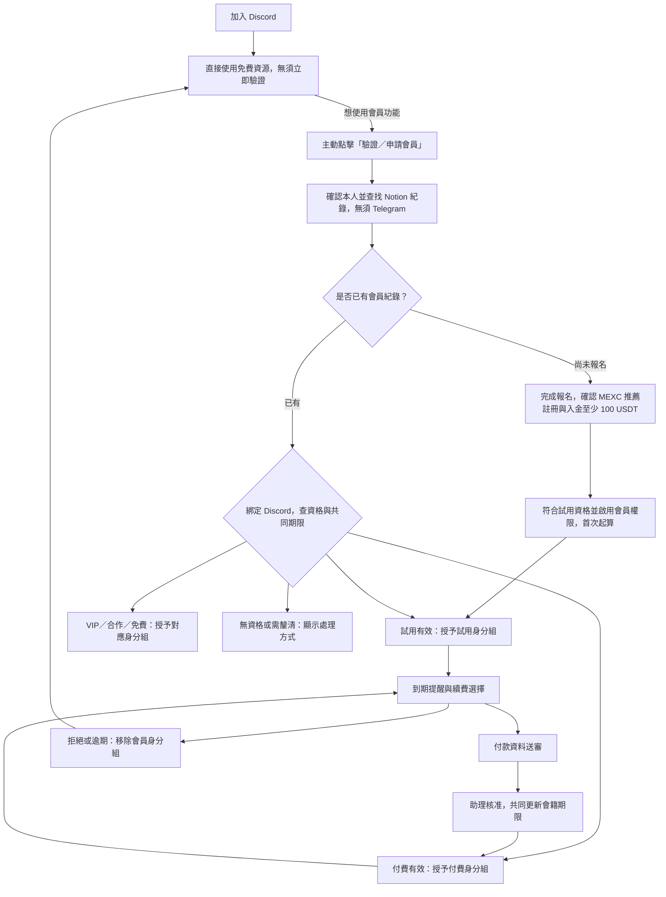

# Xplan TG Bot 驗證流程與 Discord 共用會籍研究

> 2026-09-08 實作範圍更新：使用者確認 Tally 寫入下述同一個 Notion 資料庫，本階段改為現有會員輸入 Exchange ID＋Email，直接配對 Notion 並檢查失效狀態後綁定 Discord、授予／同步身分組；不寄驗證碼，沿用既有到期日。Discord 新會員申請試用延後；續費通知與付款互動也留待後續串接。原先下方的完整流程保留作為後續設計背景，現有程式及部署說明以 [README.md](README.md) 為準。

研究日期：2026-09-07（Asia/Taipei）；2026-09-08 補查 Tally 報名表。已讀取 GitHub main 的 `2721f2d802b2a4a0859690fc86601532b650e298`、相關測試原始碼，以及 Notion 資料庫結構和匿名統計。這是研究與設計建議；沒有執行 bot、變更會員、發送通知、提交報名或修改 Discord。尚未核對正式部署使用的 commit、環境變數與 Discord 伺服器設定。

結論：可以共用現有 Notion 會員資料，但需要補上 Discord 本人綁定、身分組同步，以及兩個平台共用的會籍處理規則。使用者已確認一人一份會籍、付費一次可使用兩個平台，且共用同一個到期日；Discord 另外記錄帳號與同步結果。TG 的現有 Status 同時承載資格、入群狀態及續費進度，不能直接用「每個 Status 對應一個身分組」完成整合。

已確認的會籍規則（2026-09-07）：既有會員加入 Discord 時沿用 Notion 的 Review Due At，不重新計算試用；同一筆付款經核准後只延長一次，兩個平台依更新後的共同期限處理權限。例如 TG 試用剩 10 天，Discord 也剩 10 天。本人綁定方式、主要續費通知平台與到期寬限規則尚待討論。

已確認的 Discord 使用情境（2026-09-07）：Discord 也接收完全不使用 Telegram 的新會員，並提供免費資源。加入伺服器不要求立即完成會員驗證；使用者可以持續使用免費區，想使用會員功能時才啟動驗證／申請。免費區使用者不等於 Notion 的 exempt 免續費會員，不能因此取得會員專屬頻道權限。Discord 的完整申請與續費流程不能強制經過 Telegram。

依此建議：加入 Discord 本身不啟動試用；全新會員通過資格審核並主動啟用會員權限時才開始計時。已在 TG 或其他入口開始試用者沿用共同期限。到期未續費時只移除會員身分組，繼續保留免費區。

已確認的一般新會員試用門檻（2026-09-07）：Discord 與 TG 一樣，必須透過指定推薦連結註冊 MEXC，並入金至少 100 USDT。這是申請試用會員權限的門檻，使用 Discord 免費資源不需要先完成此資格驗證。本人驗證與 MEXC 資格查驗是不同步驟，單純驗證 Email 不能取代推薦關係及入金查驗。

已找到 [X翻倉報名表](https://www.notion.so/34f50abccc1580ef9516c8f95e51e163)，其欄位與 TG 專案吻合；尚未讀取 TG 正式環境的 NOTION_DATA_SOURCE_ID 作最終部署比對。

| 項目 | 本次唯讀核對 |
| --- | --- |
| Database ID | `34f50abc-cc15-80ef-9516-c8f95e51e163` |
| Data source ID | `34f50abc-cc15-803c-bee1-000bfc6404cb` |
| 會員紀錄 | 72 筆 |
| Status 分布 | trial_active 19、active_paid 6、exempt 4、partner 4、sent_3day_offer 1、collecting_info 1、expired 34、kicked 3 |
| Telegram User ID | 71 筆有值；非空值未發現重複 |
| Exchange UID | 66 筆有值；非空值未發現重複 |
| Discord 欄位 | 目前沒有 |
| 特別需注意的實際型別 | Telegram Username 是 title；Exchange Name 是 select；信箱欄位叫 Email |

以上是當下資料欄位統計，不能把 trial_active 或 active_paid 的筆數直接視為「目前未到期人數」。實際授權仍須核對日期。沒有把會員名單、Email、UID 值或 Token 存入此文件。

TG 的新會員驗證從 /start 開始：

1. 優先用 Telegram 數字 ID 查 Notion。找不到時，以目前 Telegram username 比對，去除 @、t.me 前綴並忽略大小寫；匹配後補寫數字 ID。名單不存在則請會員找助理，不會自動新增報名資料。
2. expired、kicked、denied 不會自動發入群連結。已在有效會員狀態且有入群時間者，回覆不必重新申請。
3. 對 eligible、collecting_info、invite_sent、join_pending，若尚無「Exchange Registered 勾選且 Exchange UID 非空」的紀錄，就收集 MEXC UID。已有 UID 時，會員提交值必須一致。
4. 呼叫 MEXC affiliate API，確認 UID 存在於所屬推薦資料且入金達門檻。程式預設門檻為 100 USDT，可由環境變數覆寫。失敗、查無 UID、UID 不符或金額不足都不放行；已標記驗證完成的資料會略過這次 API 檢查。
5. 通過後建立 24 小時有效、須 bot 審核的邀請連結。有人申請入群時，再比對 Telegram ID、Notion 狀態、邀請連結及期限；通過後撤銷連結。
6. 一般新會員在核准入群當下啟動試用，Review Due At = 入群時間 + TRIAL_DAYS，預設 30 天。partner、exempt、VIP 保留免續費資格；已付費且尚未到期的重新入群者保留原期限。

依據：[會員查找及 UID 驗證](https://github.com/trdk07/Xplan-TG-Bot/blob/2721f2d802b2a4a0859690fc86601532b650e298/lib/bot/handlers/start.ts#L24)、[邀請規則](https://github.com/trdk07/Xplan-TG-Bot/blob/2721f2d802b2a4a0859690fc86601532b650e298/lib/bot/invite.ts)、[入群核准](https://github.com/trdk07/Xplan-TG-Bot/blob/2721f2d802b2a4a0859690fc86601532b650e298/lib/bot/handlers/membership.ts#L48)、[預設設定](https://github.com/trdk07/Xplan-TG-Bot/blob/2721f2d802b2a4a0859690fc86601532b650e298/lib/config.ts)。

TG 的試用與續費流程比 README 更完整，實際排程如下：

| 時點／動作 | 程式行為 |
| --- | --- |
| 到期前 4–7 天，試用會員 | 問是否翻倉成功，改 sent_7day_survey；接著收文字收益回覆，再問是否續費 |
| 到期前 4–7 天，付費會員 | 提醒訂閱將到期，改 sent_7day_survey，不問試用成果 |
| 到期前 1–3 天 | 發訂閱方案和續費按鈕，改 sent_3day_offer |
| 到期後，仍為一般有效／提醒狀態 | 詢問是否續訂，改 renewal_due |
| 續訂 | 改 payment_pending，要求轉帳截圖與 UID 末四碼 |
| 不續訂 | 改 user_refused，保留至原到期日，排程再移出 |
| 付款資料齊全 | 仍停在 payment_pending，等待人工審核 |
| 助理確認付款 | 後台按 1 個月或 3 個月方案，更新期限並設 active_paid；需重新入 TG 者先設 join_pending |
| 到期未回、付款逾期 | 排程移出 TG，更新 expired，提供重新申請入口 |
| partner、exempt、VIP | 不進入一般到期與付款排程 |

程式內方案文字為「1 個月 50U、3 個月 100U」。付費會籍有期限；長期身分組若代表付費會員，也應隨續費延長。真正免續費的是 partner、exempt、VIP。提前續費從原到期日延長；已到期續費從當下延長，使用曆月計算。付款 webhook 目前只是占位，不會自動確認到帳。

依據：[排程](https://github.com/trdk07/Xplan-TG-Bot/blob/2721f2d802b2a4a0859690fc86601532b650e298/lib/bot/daily-job.ts#L49)、[按鈕回覆](https://github.com/trdk07/Xplan-TG-Bot/blob/2721f2d802b2a4a0859690fc86601532b650e298/lib/bot/handlers/callback.ts)、[付款資料收集](https://github.com/trdk07/Xplan-TG-Bot/blob/2721f2d802b2a4a0859690fc86601532b650e298/lib/bot/handlers/payment.ts)、[人工確認付款](https://github.com/trdk07/Xplan-TG-Bot/blob/2721f2d802b2a4a0859690fc86601532b650e298/app/admin/actions.ts#L92)、[付款 webhook](https://github.com/trdk07/Xplan-TG-Bot/blob/2721f2d802b2a4a0859690fc86601532b650e298/app/api/payment/webhook/route.ts)。日期、費率和門檻均描述此版本程式，不代表已核對正式部署設定。

以下是整合 Discord 前需處理的實際差異：

| 問題 | 影響與建議 |
| --- | --- |
| 提醒動作會覆寫 Status | 付費會員收到提醒後可能變成 sent_7day_survey 或 sent_3day_offer。Discord 不能看到不是 active_paid 就降級。需要獨立會籍類型；舊資料若無法判斷，由人工確認 |
| Paid At 是歷史付款時間 | 不能只要 Paid At 非空就授予付費身分組；本次有 25 筆 Paid At 非空，但只有 6 筆 Status 是 active_paid |
| 一般續費未統一提供 3 天寬限 | sendPaymentRequest 優先把付款期限設成原 Review Due At。到期後才選續訂會得到過去的期限；重新申請／管理員補件等路徑才使用 now + PAYMENT_GRACE_DAYS |
| renewal_due 沒有延長回覆截止日 | 到期當次排程先問續費，下一次執行遇到已過 Review Due At 的 renewal_due 就移出。既有測試也明確描述無寬限期，不能把預設設定 3 天解讀成所有路徑都有 3 天 |
| 付款資料待審仍可能被移出 | 截圖和末四碼齊全後仍是 payment_pending；每日任務只看付款截止日，不會因待審核暫停移出。Discord 應另定待審核處理規則 |
| TG 流程依賴 Telegram ID | 日常任務會向會員 Telegram ID 發訊息或踢群。若加入僅使用 Discord 的會員，不能原樣重用此任務 |
| 入群時間與會籍期限綁在一起 | Discord 驗證、退出重進及 TG 入群都不能重設同一份試用期限。新會員先進 Discord 的路徑，需要與 TG 一起調整 |
| 未知 Status 預設 eligible | TG 的解析器會把未知／空狀態視為 eligible。Discord 遇到不明資格時應待確認，避免因此發角色 |

來源：[Status 定義](https://github.com/trdk07/Xplan-TG-Bot/blob/2721f2d802b2a4a0859690fc86601532b650e298/lib/status.ts)、[付款期限](https://github.com/trdk07/Xplan-TG-Bot/blob/2721f2d802b2a4a0859690fc86601532b650e298/lib/bot/handlers/payment.ts#L22)、[排程移除](https://github.com/trdk07/Xplan-TG-Bot/blob/2721f2d802b2a4a0859690fc86601532b650e298/lib/bot/daily-job.ts#L55)、[Notion 狀態解析](https://github.com/trdk07/Xplan-TG-Bot/blob/2721f2d802b2a4a0859690fc86601532b650e298/lib/notion.ts#L146)。這些是閱讀程式與測試得出的結論，本次沒有執行測試或重現正式環境操作。

依已確認的免費區與自願驗證情境，建議的 Discord 使用者流程是：

Discord 免費區與會員專屬頻道分開授權。建議到期者保留一般伺服器成員資格，以身分組控制會員頻道，之後續費即可恢復權限。Discord 支援按鈕、表單、僅本人可見的互動回覆，以及新增／移除身分組；bot 的最高角色須高於它管理的角色，並取得 Manage Roles 權限。[互動介面](https://docs.discord.com/developers/interactions/overview)、[回覆機制](https://docs.discord.com/developers/interactions/receiving-and-responding)、[身分組權限](https://docs.discord.com/developers/platform/server-and-channel-management)。

本人綁定建議以 Email 驗證碼提供不依賴 Telegram 的入口：既有會員驗證 Notion 紀錄中的 Email 後，將 Discord User ID 綁定同一筆資料；全新會員則需完成報名及資格審核，Email 驗證成功本身不代表已取得試用資格。找不到、重複或有綁定衝突的資料交由助理確認，不直接新增另一份會籍。這是建議方案，尚未串接郵件服務。

使用者於 2026-09-08 提供 [Tally 報名表 RGYNNl](https://tally.so/r/RGYNNl)。實際公開標題為「申請X-plan候選」，已用瀏覽器讀取畫面及輸入欄位的 required 屬性；TG 帳號與 LINE ID 都是必填，因此目前無法直接支援沒有 TG 帳號的人正常完成填寫。以下只描述公開頁面當下顯示的欄位，未填寫或送出表單，也未查閱 Tally 編輯後台的條件邏輯或整合設定。

| 表單目前顯示的欄位 | 必填 | Discord 共用流程建議 |
| --- | --- | --- |
| 群組暱稱 | 是 | 可沿用作人工辨識；不是身分驗證依據 |
| LINE ID | 是 | 建議選填，除非仍有明確的 LINE 聯絡需求 |
| EMAIL（盡可能 GMAIL） | 是 | 保留，用於對應 Notion Email 及建議中的驗證碼流程 |
| TG 帳號 | 是 | 改選填；可補充「只使用 Discord 者可留空」 |
| 是否有基本技術分析 | 是 | 有／略懂／完全沒有；可沿用作背景資料 |
| 預計翻倉的本金 | 是 | 可沿用作背景資料；不能當作實際入金已達標的證明 |
| 期許可以翻到的金額 | 是 | 可沿用作背景資料 |

目前顯示的頁面沒有 MEXC UID、Discord 帳號、推薦連結或 100 USDT 資格說明；這不代表 Tally 後台一定沒有條件欄位或送出後流程。為減少表單調整，建議 MEXC UID 在 Discord 會員驗證時收集：先以 Email 驗證本人並匹配 Notion 紀錄，再提交 UID；若原紀錄有 UID 必須一致，查驗推薦關係與實際入金後才開通。已存在有效會籍者綁定原紀錄及期限，不重新啟動試用。Discord User ID 由互動事件取得，不要求使用者手動輸入。

建議的最小表單調整：TG 帳號選填，LINE ID 視聯絡需求改選填；保留 Email；增加會員試用門檻、報名不等於開通，以及完成後回 Discord 點驗證的說明。表單本身不直接啟動試用，也不直接授予會員角色。以上仍是待討論修改，尚未操作 Tally 後台。

公開表單無法證實 Tally → Notion 的映射。正式整合前需核對此 form ID 的實際目標 data source，及 Email、TG 帳號、預計本金、目標金額等欄位的對應；TG 帳號留空是否仍能建立可辨識的 Notion 紀錄也要驗證。不可因公開標題與 Notion 資料庫標題不同，就直接斷定使用者提供了錯誤表單。同步完成前應提示會員稍後重試，不因暫時查不到就新增重複紀錄。

既有 TG 會員可選擇擴充後的 TG bot 一次性憑證作為輔助綁定方式，但不是 Discord 的必經步驟。驗證憑證需綁定發起者、限時、一次性使用，並限制重試與重複綁定。輸入 Email、TG username 或交易所 UID 本身只能定位資料，不能單獨證明本人；不建議以「填入資料相符」直接授權。Discord 的固定數字 User ID 應作為後續綁定鍵，顯示名稱僅供辨識。

暫定角色對照需同時看資格、日期和會籍類型：

| Notion 狀態／條件 | 建議 Discord 行為 |
| --- | --- |
| 尚未驗證／尚無 Notion 紀錄 | 可使用免費區；不授予會員專屬權限、不啟動試用、不標記 exempt |
| trial_active，期限有效 | 試用身分組 |
| active_paid，期限有效 | 付費身分組 |
| partner、exempt、VIP | 對應的免續費／長期身分組 |
| sent_7day_survey、sent_3day_offer | 期限有效時維持原會籍類型；首次綁定若類型不明則待確認 |
| user_refused | 保留原角色至期限，不再追問續費 |
| renewal_due、payment_pending | 依明確回覆期限、付款期限及待審核規則處理 |
| eligible、collecting_info、invite_sent、join_pending | 必須判斷資格與入會流程，不能直接視為付費或重新給 30 天 |
| expired、kicked、denied | 不授予會員角色；已持有者依停權規則移除 |
| 狀態缺失、日期異常、查詢失敗 | 不新增權限；查詢故障不能當作全員到期而批量移除 |

為避免兩個 bot 互相改寫，建議規劃如下：

- 共用會籍資料：會員類型、會員狀態、原始試用起點、到期日、付款審核結果。會員類型須獨立於提醒進度。
- Discord 專屬資料：Discord User ID、Discord Verified At、Discord Joined At、Discord Last Sync At、Discord Role State。若 Discord 也發提醒，另記通知期別、階段與結果，不能覆寫 TG 的 Last Bot Message 或借用其提醒標記。
- 單一會籍處理入口：兩邊的續費選擇及人工核准都交給同一套規則寫回 Notion；確保同一筆付款只延長一次。Discord 必須提供不依賴 TG 的申請、續費與付款資料送審入口；不能把沒有 TG 的會員導向 TG 完成流程。
- 平台獨立性：Telegram User ID 可為空，Discord User ID 也可為空，但實際處理某平台通知或權限前須確認已綁定該平台。TG 發送失敗不能阻止 Discord 的會籍處理；Discord 到期提醒也不能依賴 TG 已完成對話。
- 付款憑證：現有 Payment Proof File ID 是 Telegram 檔案識別，Discord 上傳應另存來源與可供助理查看的憑證，不能直接塞進該欄位。
- 定期同步：用同一個「應有身分組」計算處理驗證、續費完成與排程校正；只管理指定會員角色，保留其他伺服器角色。私訊失敗時保留個人查詢／續費入口並記錄待處理通知。
- 首次試用：依已確認的共同會籍規則，只啟動一次；加入另一個平台或退出重進都沿用既有 Review Due At。加入 Discord 免費區不觸發計時；全新會員的起算事件建議是通過資格審核並主動啟用會員權限。

技術上可沿用 TypeScript 與 Cloudflare，使用 Discord HTTP interactions 接驗證按鈕／表單，排程同步角色。Discord 官方提供 Workers 部署範例；因此不必為了驗證按鈕另外維持常駐連線。若希望即時處理所有入群事件，則另評估 Gateway 事件需求。[Discord Workers 範例](https://docs.discord.com/developers/tutorials/hosting-on-cloudflare-workers)。

目前決策與待討論事項：

| 決策 | 建議起點 |
| --- | --- |
| TG 與 Discord 是否共用一份會籍及期限？ | 已確認：付費一次可使用兩邊；TG 剩 10 天，進 Discord 也剩 10 天，續費同步生效 |
| 是否允許完全不使用 TG 的 Discord 新會員？ | 已確認：允許；完整流程不可強制使用 Telegram。建議 Email 本人驗證，TG 綁定僅為選配 |
| 加入 Discord 是否必須立即驗證？ | 已確認：不必；未驗證者可以使用免費資源，會員功能才需主動驗證／申請 |
| Discord 新會員的試用資格？ | 已確認：指定推薦連結註冊 MEXC，並入金至少 100 USDT |
| 全新會員如何報名？ | 已查閱 RGYNNl 表單：TG 帳號與 LINE ID 都必填；建議 TG 改選填後沿用，實際 Tally → Notion 映射仍待核對 |
| 續費通知與期限如何處理？ | 決定主要通知平台；到期回覆、付款及待審核期限分別明定，避免雙重提醒及已交憑證仍被降權 |

共同會籍、到期日、Discord 獨立新會員、免費區自願驗證情境，以及 MEXC 推薦註冊和至少 100 USDT 入金的試用門檻已確認，其餘為待討論設計；尚未修改 Notion schema、TG 程式或 Discord 伺服器。
